


 


Every product has three layers: the screen people use, the server behind it and the cloud it runs on. 
<b>I build across all three</b>, and I add AI where it earns its place. Computer Science student, 
currently a Software Engineer &amp; Full Stack Intern.


 



 

<!--projects-->


<picture>
<source media="(max-width: 700px)" srcset="./assets/proj-1-m.svg">
</picture>

<b>How MEDIVORAX works</b>, step by step

1. **Staff uploads a supplier bill**: A photo, PDF or spreadsheet, sent from the Next.js app.
2. **NestJS API checks the request**: Verifies the JWT and membership, then selects that hospital's schema.
3. **OCR service reads the bill**: FastAPI + PaddleOCR; PDFs that already contain text skip OCR.
4. **Lines are extracted and matched**: Invoice number, GSTIN and items; each item matched to the catalogue by brand and trigram similarity.
5. **Staff confirms the suggestions**: Nothing changes stock until a person approves; a wrong match is worse than a blank.
6. **Stock ledger is updated**: Purchase invoice, batches and an append-only stock movement are written.
7. **Staff searches for a medicine**: By name, code or composition; ranked exact → prefix → trigram over 252,678 records.
8. **Results and substitutes appear**: Substitutes are in-stock medicines with exactly the same composition.

| Part | Technology |
| --- | --- |
| Frontend | Next.js 16 · React 19 · TypeScript · Tailwind 4 |
| Backend | NestJS 11 · SQL via pg · JWT · argon2 |
| Data | PostgreSQL · pg_trgm · one schema per hospital |
| OCR | Python · FastAPI · PaddleOCR |

**Also built:** Inventory + FEFO, POS billing, Returns, Purchase orders, Wastage, Reports. 
**Planned, not built yet:** AI copilot, Diagnostics, QR prescriptions, Demand prediction. 
*No LLM, embeddings or semantic search in the code yet: medicine search is lexical + trigram.*

 

<picture>
<source media="(max-width: 700px)" srcset="./assets/proj-2-m.svg">
</picture>

<b>How SENTILEX works</b>, step by step

1. **Train offline**: Clean CICIDS2017, split 60/20/20, train XGBoost and a Keras MLP, save the SHAP explainer.
2. **Replay network flows**: Rows from a CICIDS-format file stand in for live traffic.
3. **Classify each flow**: XGBoost by default; the MLP is a selectable baseline.
4. **Attack or benign?** Benign or below its class threshold: stored as a flow, no alert.
5. **Create the alert with SHAP**: The features that pushed the prediction are saved with it; LIME is available on request.
6. **Find matching ATT&CK techniques**: ChromaDB looks up related MITRE ATT&CK techniques and mitigations.
7. **Write the explanation**: Ollama (llama3.1:8b) explains the alert using only the evidence it is given.
8. **Check the explanation**: EFM scores whether its claims match the evidence; low scores need a human.
9. **Simulated prevention**: A rule row is added or suggested in the database; no real firewall is touched.
10. **Analyst reviews and approves**: React dashboard with alerts, explanations and pending actions.

| Part | Technology |
| --- | --- |
| Frontend | React 19 · TypeScript · Vite |
| Backend | FastAPI · SQLAlchemy · WebSocket |
| ML | XGBoost · Keras MLP · SHAP · LIME |
| AI | ChromaDB · Ollama llama3.1:8b |
| Data | SQLite |
| Infra | Docker Compose |

*Named SentinelX in the code. Traffic is replayed from dataset files; prevention only writes rows to a rules table.*

 

<picture>
<source media="(max-width: 700px)" srcset="./assets/proj-3-m.svg">
</picture>

<a href="https://github.com/Manish-111913/INDUS_MIND"><b>Source code</b></a>

<b>How IndusMind works</b>, step by step

1. **Upload plant documents**: Manuals, P&IDs, shift logs, regulations; originals stored in MinIO / S3.
2. **Read the text**: PyMuPDF text layer; scanned pages through PaddleOCR, Tesseract as fallback.
3. **Split into chunks**: 400–600 tokens with 15% overlap; tables stay whole.
4. **Embed and index**: bge-large vectors in pgvector (HNSW) plus a Postgres full-text index.
5. **Extract entities into a graph**: Rules plus an optional LLM pass, projected into Neo4j for the graph explorer.
6. **An engineer asks a question**: In plain language, from the React app.
7. **Already answered?** Near-identical questions (cosine ≥ 0.97) reuse a cached answer for 24 hours.
8. **Hybrid retrieval**: Vector top-40 + full-text top-40, fused with RRF; equipment tags boost their documents.
9. **Generate the answer**: An LLM (Claude by default) answers from numbered context blocks.
10. **Verify the citations**: Any [n] that doesn't point to a retrieved chunk is removed.

| Part | Technology |
| --- | --- |
| Frontend | React 19 · Vite · Tailwind 4 |
| Backend | FastAPI · Celery · Redis |
| Data | PostgreSQL + pgvector · Neo4j · MinIO / S3 |
| AI | bge-large embeddings · Claude by default (OpenAI, Gemini, Ollama optional) |
| OCR | PyMuPDF · PaddleOCR · Tesseract |

*Not in the code: Elasticsearch, Pinecone, LangChain, Next.js, or a reranker.*

 

<picture>
<source media="(max-width: 700px)" srcset="./assets/proj-4-m.svg">
</picture>

<a href="https://github.com/Manish-111913/3D-CAMPUS-TOUR-FRONTEND"><b>Frontend</b></a>
&nbsp;·&nbsp;
<a href="https://github.com/Manish-111913/3D-CAMPUS-TOUR-BACKEND"><b>Backend</b></a>

<b>How 3D Campus Tour works</b>, step by step

1. **Sign in**: Email and password; the Express API returns a JWT.
2. **Pick a place**: The location list comes from the API: 5 places in the current build.
3. **Load the 3D model**: Three.js GLTFLoader fetches the .glb; the previous model is disposed first.
4. **Fetch the hotspots**: Hotspots for this model come from MongoDB through the API.
5. **Walk around**: First-person controls with WASD and the mouse.
6. **Hotspot clicked?** Raycasting finds the hotspot under the cursor.
7. **Show the info card**: A tooltip explains that spot.
8. **Admins edit hotspots**: Add, drag and edit; changes are saved through the API (admin role only).

| Part | Technology |
| --- | --- |
| Frontend | HTML · CSS · JavaScript · Three.js r128 (WebGL) |
| 3D | GLTFLoader · pointer-lock controls · raycasting |
| Backend | Node.js · Express · JWT · bcrypt |
| Data | MongoDB Atlas (Mongoose) |
| Hosting | Netlify (site) · Render (API) |

*The public repos show 5 locations as 3D models; no panoramas or React Three Fiber.*

 

<picture>
<source media="(max-width: 700px)" srcset="./assets/proj-5-m.svg">
</picture>

<b>How AI Jewellery Design works</b>, step by step

1. **Collect paired images**: Each sketch has a matching target image.
2. **Preprocess**: OpenCV resizes and cleans every image the same way.
3. **Generator draws**: A U-Net generator turns a sketch into an image.
4. **Discriminator judges**: A PatchGAN checks image patches for realism (training only).
5. **Update both networks**: Adversarial loss + L1 loss; repeat across the dataset.
6. **Save the generator**: Only the generator is needed after training.
7. **A new sketch comes in**: Normalised exactly like the training data.
8. **Generate a concept**: One forward pass through the trained generator.
9. **Designer reviews it**: A visual concept, not a manufacturable CAD model.

| Part | Technology |
| --- | --- |
| ML | Python · TensorFlow · Pix2Pix conditional GAN |
| Images | OpenCV |

*From project documentation; the source code was not available to review, and no accuracy figure is claimed.*

 

<picture>
<source media="(max-width: 700px)" srcset="./assets/proj-6-m.svg">
</picture>

<a href="https://github.com/Manish-111913/AI-JD"><b>Source code</b></a>

<b>How Candidate Ranking works</b>, step by step

1. **Load 100,000 profiles**: Validated and normalised from the challenge dataset.
2. **Build one text per profile**: Title, headline, summary, last 3 roles and top 8 skills.
3. **Embed once, offline**: all-MiniLM-L6-v2 gives a 100,000 × 384 NumPy matrix saved to disk.
4. **A job description comes in**: Requirements, plus overrides from the UI.
5. **Score every candidate**: Cosine similarity combined with skills, career, experience, location and education signals.
6. **Keep a shortlist**: Top 300, or 30% of a smaller pool.
7. **Rerank with a cross-encoder**: Reads each job-candidate pair together for a sharper relevance score.
8. **Blend and cut to 100**: 0.4 × rule score + 0.6 × cross-encoder score.
9. **Recruiter reviews**: Score breakdowns, reasoning and CSV export in the dashboard.

| Part | Technology |
| --- | --- |
| Frontend | Next.js 15 · React 19 · TypeScript · Tailwind 4 |
| Backend | FastAPI · live progress over SSE |
| Models | all-MiniLM-L6-v2 bi-encoder · ms-marco-MiniLM-L-6-v2 cross-encoder |
| Search | NumPy dot product, no vector DB |
| Infra | Docker · Hugging Face Spaces |

 

<picture>
<source media="(max-width: 700px)" srcset="./assets/proj-7-m.svg">
</picture>

<a href="https://github.com/Manish-111913/EcoSphere_Enterprise-ESG-Management-Platform"><b>Source code</b></a>

<b>How EcoSphere works</b>, step by step

1. **Enter ESG data**: Operational records, CSR activities, training, diversity and policies, by form or file import.
2. **Guard and validate**: JWT, a permission check per action and input validation; every write is audit-logged.
3. **Store the records**: PostgreSQL via Prisma, with separate environmental, social and governance models.
4. **Calculate CO2e**: Quantity × the active emission factor, with the factor saved alongside the result.
5. **Score departments and the company**: Metrics normalised and weighted into E, S and G scores, recomputed daily.
6. **Role dashboards**: Each role sees its own view, built with React and Recharts.
7. **Reports**: Environmental, social, governance and summary reports; CSV and XLSX export.
8. **Human review**: Approvals for CSR participation, policies, audits and compliance issues.

| Part | Technology |
| --- | --- |
| Frontend | React 19 · Vite · TypeScript · Tailwind 4 · Recharts |
| Backend | NestJS 10 · class-validator · scheduled jobs |
| Data | PostgreSQL 16 · Prisma 5 |
| Auth | JWT + rotating refresh tokens · argon2 |

**Also built:** 7 roles, permission per action, data scope: own · dept · all, audit log. 
**Planned, not built yet:** PDF export, email delivery. 
*Built for the Odoo Hackathon brief but implemented on NestJS + React; there are no Odoo modules in the code.*

 

<picture>
<source media="(max-width: 700px)" srcset="./assets/proj-8-m.svg">
</picture>

<a href="https://github.com/Manish-111913/DEALFLOW360"><b>Source code</b></a>

<b>How DealFlow360 works</b>, step by step

1. **Draft a quotation**: Lines, quantities and discounts for a customer.
2. **Score the risk**: Ceiling breaches, margin shortfall, negotiation rounds and delivery risk give a score from 0 to 100.
3. **Approval needed?** Yes if any line breaks its discount ceiling or the score falls in an approval band.
4. **Approval chain**: Manager from 30, Finance from 60; each approver is checked by role.
5. **Customer portal**: The customer opens the quote through a magic link; internal fields are stripped.
6. **Counter or confirm?** A counter-offer is re-scored at once and may need re-approval.
7. **Confirm the order**: A version check rejects the confirmation if the terms changed meanwhile.
8. **Plan fulfilment**: Split across warehouses: fewest shipments first, then cost.
9. **Bill it**: One-time and recurring invoices, issued by staff.
10. **Track deal health**: 100 minus penalties, pushed live to the dashboard over WebSocket.
11. **Gemini assists**: Explains quotes, drafts messages and suggests next actions; code computes the numbers.

| Part | Technology |
| --- | --- |
| Frontend | Next.js 16 · React 19 · TypeScript · Tailwind |
| Backend | Next.js API routes → framework-free TypeScript domain · Zod |
| Data | PostgreSQL 17 · Prisma 7 |
| Auth | Auth.js: credentials, Google, portal magic link |
| AI | Google Gemini |
| Realtime | WebSocket hub fed by Postgres NOTIFY |

*Uses an Odoo Hackathon brief as requirements but is not built on Odoo. No lead stage, email, CRM or payment gateway.*

 

<picture>
<source media="(max-width: 700px)" srcset="./assets/proj-9-m.svg">
</picture>

<b>How Pharmacy App Prototype works</b>, step by step

1. **Open the app**: A web prototype built in 135 minutes.
2. **Browse or search**: Look for a medicine by name or browse the list.
3. **Catalog search** *(not verified)*: A Django backend is recorded; the exact search logic was not verified.
4. **Matching results**: Medicines that match the query.
5. **Medicine details**: The detail view for one medicine.
6. **Next step** *(not verified)*: Cart or ordering features could not be verified.

| Part | Technology |
| --- | --- |
| Frontend | HTML · CSS · JavaScript · Bootstrap |
| Backend | Python · Django |

*From portfolio records; the source was not available to review. Not affiliated with Apollo Pharmacy.*

 
<!--/projects-->


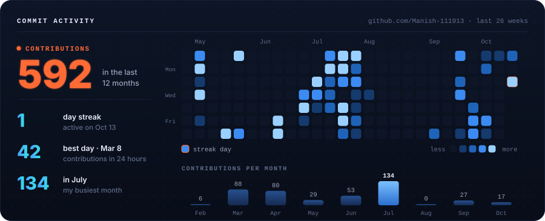

Drawn from my real GitHub contributions and refreshed every hour by a GitHub Action.

 



 


<a href="https://www.linkedin.com/in/kotasriramamanish07/"></a>
<a href="https://drive.google.com/file/d/1-nRGWdWntkj9s5_u0zdx_nYxoeablMRz/view?usp=sharing"></a>
<a href="https://github.com/Manish-111913"></a>


